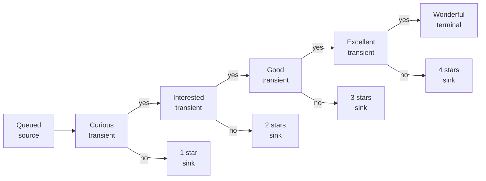

# Pipeline Graph & Stage Album Listing

How to **reconstruct the pipeline graph** for one `group` from exported Firestore `playlists` documents, and how the app **lists albums in each stage** today.

**Related:**

- [Firestore: Albums, Playlists & User Entries](./firestore-albums-playlists-user-entries.md)
- [Playlist History: User Actions](./playlist-history-user-actions.md)
- Export format: `dbscripts/export-seed-data.js` → `dbscripts/seed-data/playlists.json`

**Implementation references:** `src/composables/usePlaylistData.js` (`derivePipelineOrder`), `src/views/playlists/PlaylistView.vue`, `src/views/playlists/PlaylistSingle.vue`

---

## 1. Exported playlist document shape

`npm run export:seed-data` writes an array of:

```json
{
  "id": "<firestoreDocumentId>",
  "data": {
    "playlistId": "<externalPlaylistId>",
    "userId": "<uid>",
    "group": "new",
    "pipelineRole": "transient",
    "nextStagePlaylistId": "<firestoreDocumentId or null>",
    "terminationPlaylistId": "<firestoreDocumentId or null>",
    "createdAt": { "_type": "timestamp", "_seconds": 0, "_nanoseconds": 0 },
    "updatedAt": { "_type": "timestamp", "_seconds": 0, "_nanoseconds": 0 },
    "deletedAt": null
  }
}
```

### Two ID spaces (critical)

| ID | Field | Used for |
|----|--------|----------|
| **Firestore doc ID** | Export `id`; stored in `nextStagePlaylistId`, `terminationPlaylistId` | Pipeline **graph edges** between stages |
| **External playlist ID** | `data.playlistId` | Spotify playlist identity; **album listing**, routing to `/playlist/:id` |

Connection fields always point at **Firestore doc IDs**, not external `playlistId` values.

---

## 2. Filter exports to one group

Given `playlists.json` for a user:

1. Keep documents where `data.group === '<group>'` (e.g. `'new'` or `'known'`).
2. Drop documents where `data.deletedAt != null` (soft-deleted stages are excluded everywhere in the app).
3. Normalize each stage to an internal node:

| Normalized field | Source |
|------------------|--------|
| `firebaseId` | export `id` |
| `playlistId` | `data.playlistId` |
| `group` | `data.group` |
| `pipelineRole` | `data.pipelineRole` (default `'transient'` if missing) |
| `nextStagePlaylistId` | `data.nextStagePlaylistId` or `null` |
| `terminationPlaylistId` | `data.terminationPlaylistId` or `null` |
| `createdAt` | deserialize timestamp if needed |

---

## 3. Reconstruct the pipeline graph

The app does **not** store a ordered stage list. Order and display metadata are **derived** by `derivePipelineOrder()` in `usePlaylistData.js`.

### 3.1 Build adjacency

For each stage node `P` in the group:

| Edge | From field | To node |
|------|------------|---------|
| **Progress** | `P.nextStagePlaylistId` | Next stage along the main path |
| **Terminate** | `P.terminationPlaylistId` | Sink for that evaluation step (transients only) |

Build `playlistMap: firebaseId → node`.

### 3.2 Traverse from sources (display order)

1. **Sources:** all nodes with `pipelineRole === 'source'`, sorted by `createdAt` ascending (oldest first).
2. **DFS from each source** (`traverse`):
   - Mark visited; append node to `ordered` list.
   - If node is **transient** and has `terminationPlaylistId`, **immediately visit the sink** (if role is `'sink'` and not yet visited) and append it right after the transient.
   - Then follow `nextStagePlaylistId` recursively.

This interleaves each transient with its star-rating sink in the UI list, e.g. `Curious → 1★ → Interested → 2★ → …`.

3. **Orphans:** nodes not reached from any source get `pipelinePosition >= 1000` and are appended at the end.

### 3.3 Assign `pipelinePosition` / `totalPositions` (rating bar)

After traversal, only for nodes with `pipelinePosition < 1000`:

1. Collect **sinks and terminals** in traversal order → `sinksAndTerminals`.
2. `totalPositions = sinksAndTerminals.length` (typically 5: four sinks + one terminal).
3. Assign sinks/terminals **0-based** positions `0 … totalPositions-1` in that order.
4. Each **transient** with a `terminationPlaylistId` copies the **same position** as its linked sink.
5. **Sources** keep their raw traversal index (used differently in the rating bar UI).

### 3.4 Canonical onboarding topology (`new` / `known`)

Onboarding (`generateCompletePipelines`) creates 10 stages per group with this **logical** graph (names are Spotify-facing; Firestore links use doc IDs):



| Stage | `pipelineRole` | `nextStagePlaylistId` | `terminationPlaylistId` |
|-------|----------------|-------------------------|---------------------------|
| Queued | `source` | Curious | — |
| Curious | `transient` | Interested | 1 star |
| 1 star | `sink` | — | — |
| Interested | `transient` | Good | 2 stars |
| 2 stars | `sink` | — | — |
| Good | `transient` | Excellent | 3 stars |
| 3 stars | `sink` | — | — |
| Excellent | `transient` | Wonderful | 4 stars |
| 4 stars | `sink` | — | — |
| Wonderful | `terminal` | — | — |

Custom groups use the same **roles and edge types**; only `group` and playlist count may differ.

### 3.5 Example: ordered list from exports

After `derivePipelineOrder`, a full `new` group typically appears as:

1. Queued (`source`)
2. Curious (`transient`)
3. 1 star (`sink`)
4. Interested (`transient`)
5. 2 stars (`sink`)
6. Good (`transient`)
7. 3 stars (`sink`)
8. Excellent (`transient`)
9. 4 stars (`sink`)
10. Wonderful (`terminal`)

**Playlist View** renders this vertical list (one row per stage). Toggle **“Hide rating playlists”** filters out `pipelineRole === 'sink'`, leaving transients + source + terminal.

---

## 4. How albums are listed in each stage today

### 4.1 Source of truth: external playlist contents

**The album list on a stage page is not queried from Firestore.**

`PlaylistSingle` (`/playlist/:id` where `:id` is **external** `playlistId`):

1. Calls `getPlaylistAlbumsWithDates(playlistId)` → Spotify `GET /playlists/{id}/items`.
2. Derives **unique album IDs** from track items (first `added_at` per album wins).
3. That array drives what appears in the stage.

Firestore `albums.userEntries.*.playlistHistory` does **not** filter this list. An album can appear in the Spotify playlist while Firestore says it is elsewhere or not in the DB (`inCollection === false`).

### 4.2 Sorting

Default: **date added** (`addedAt` from Spotify), ascending.

User can switch sort mode (`PlaylistSingle`):

| Mode | Sort key |
|------|----------|
| `date` (default) | Spotify `added_at` |
| `year` | `releaseYear` from Firestore root / Spotify fallback |
| `name` | `albumTitle` |
| `artist` | `artistName` |
| `loved` | Last.fm loved-track % (when tracklists enabled) |

Direction toggles asc/desc. Sort is applied to the full album ID list, then paginated.

### 4.3 Pagination & metadata hydration

| Setting | Value |
|---------|--------|
| Page size | 20 albums |
| Album details | Firestore `albums` batch first, Spotify `loadAlbumsBatched` for gaps |
| Per-album Firestore overlay | `fetchAlbumsData` → `inCollection`, `playlistHistory`, rating bar inputs |

### 4.4 Per-album UI overlays (Firestore)

For each album on the page:

| UI | Firestore source |
|----|------------------|
| **In collection / Add button** | User has `userEntries[uid]` on album doc |
| **Rating bar** | Current history entry (`removedAt == null`): `pipelineRole`, `type`, `playlistId` |
| **Yes / No / Undo** | Current stage doc: `nextStagePlaylistId`, `terminationPlaylistId`, `pipelineRole` |
| **Pipeline position width** | `derivePipelineOrder` output for **this** stage’s `firebaseId` in the group |

**Rating bar note:** width/stars use the **viewed stage’s** `pipelinePosition`, but the bar role icon comes from the album’s **global** current history entry. If Spotify and Firestore are out of sync, the bar can disagree with the stage you are viewing.

### 4.5 Stage row summary (Playlist View)

Each stage row merges Firestore graph node + Spotify summary (`loadPipelinePlaylists`):

| Displayed | Source |
|-----------|--------|
| Name, cover image | Spotify `getPlaylist(playlistId)` |
| Track count | Spotify `playlist.tracks.total` |
| Order in list | `derivePipelineOrder` |
| Click target | `/playlist/{playlistId}` (external ID) |
| Edit / delete | `firebaseId` |

---

## 5. Reconstructing album membership from exports only

If you have **only** Firestore exports (no Spotify API), you can approximate “which albums belong to which stage” differently from the live app:

**Per user, per album** in `albums.json`:

1. Read `data.userEntries[uid].playlistHistory`.
2. Find the entry with `removedAt == null` (current stage).
3. Match `entry.playlistId` to a stage’s external `playlistId`.

That gives **Firestore’s idea** of current stage per album. It will **not** match Spotify playlist contents when:

- User added albums on Spotify without backfilling DB
- Remove/move failed on one side only
- Batch “missing albums” backfill is incomplete

For **historical** membership (albums that passed through a stage), scan all history entries with matching `playlistId`, regardless of `removedAt`.

---

## 6. Reconstruction checklist

Use this when reading `playlists.json` for one `group`:

```
[ ] Filter by group; exclude deletedAt
[ ] Build firebaseId → node map
[ ] Find source(s); sort by createdAt
[ ] Walk nextStagePlaylistId chains
[ ] At each transient, also link terminationPlaylistId → sink
[ ] Mark orphans (unreachable from sources)
[ ] Assign sink/terminal positions for rating bar math
[ ] Map each node’s playlistId for album lookups

Album listing (matches app today):
[ ] For each stage, list albums from Spotify playlist items (external playlistId)
[ ] Sort by added_at (default asc); paginate 20/page

Album listing (Firestore-only offline):
[ ] albums where current playlistHistory.playlistId === stage.playlistId
```

---

## 7. Role reference

| `pipelineRole` | Outgoing edges | Album movement UI |
|----------------|----------------|-------------------|
| `source` | `nextStagePlaylistId` only | Add album; advance (Yes) if next configured |
| `transient` | `nextStagePlaylistId` + `terminationPlaylistId` | Yes → next; No → sink |
| `sink` | none | Undo → previous stage (from history) |
| `terminal` | none | Undo → previous stage (from history) |

See [Playlist History: User Actions](./playlist-history-user-actions.md) for when history entries are appended or closed.

---

## 8. Minimal reconstruction pseudocode

```text
function reconstructGroup(playlistsExport, groupName):
  nodes = []
  for doc in playlistsExport:
    if doc.data.group != groupName: continue
    if doc.data.deletedAt != null: continue
    nodes.push(normalize(doc))

  map = { n.firebaseId: n for n in nodes }

  ordered = []
  visited = set()
  sources = sort(nodes where role == 'source', by createdAt)

  function traverse(p):
    if not p or p.firebaseId in visited: return
    visited.add(p.firebaseId)
    ordered.append(p)
    if p.role == 'transient' and p.terminationPlaylistId:
      sink = map[p.terminationPlaylistId]
      if sink and sink.role == 'sink' and sink.firebaseId not in visited:
        visited.add(sink.firebaseId)
        ordered.append(sink)
    if p.nextStagePlaylistId:
      traverse(map[p.nextStagePlaylistId])

  for s in sources: traverse(s)

  for p in nodes:
    if p.firebaseId not in visited:
      p.orphan = true
      ordered.append(p)

  return ordered   // same order Playlist View uses before Spotify hydration
```

---

*Today the pipeline graph lives in Firestore; the albums on each stage live in Spotify. Firestore is the stage manager, Spotify is the warehouse floor — and the app displays whatever is on the floor, not whatever the clipboard says should be there.*
