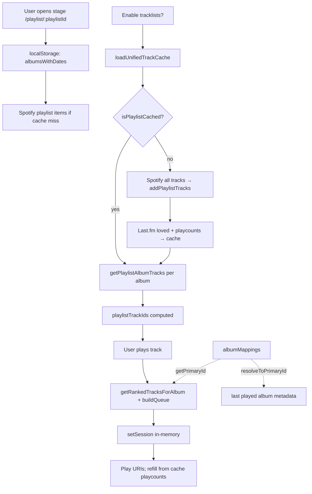
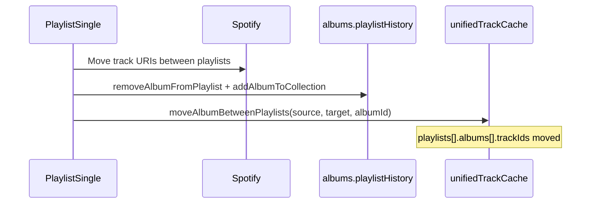

# Playback Path: Persisted Data

Reference for **persisted and session data** on the album ↔ pipeline ↔ playback path only. Covers identity resolution (`albumMappings`), per-stage track inclusion, playcounts, loved status, queue selection, and the unified track cache.

**Out of scope:** recommendations, friends, social features, discovery/search.

**Related:**

- [Firestore: Albums, Playlists & User Entries](./firestore-albums-playlists-user-entries.md)
- [Playlist History: User Actions](./playlist-history-user-actions.md)
- [Pipeline Graph & Stage Album Listing](./pipeline-graph-and-stage-album-listing.md)

---

## Storage layers (summary)

| Layer | Where | Role on playback path |
|-------|--------|------------------------|
| **Firestore** | `albumMappings`, `albums`, `playlists` | Album identity; pipeline stage links; optional album metadata for UI |
| **localStorage** | `user_tracks_{uid}`, playlist caches, preferences | Track cache (playcount, loved, per-stage track lists); album order per stage |
| **In-memory** | `useQueueSession` refs, unified cache RAM mirror | Active playlist queue session; hot read path for tracks |

---

## 1. `albumMappings` (Firestore)

**Collection:** `albumMappings`  
**Document ID:** Auto-generated.

### Fields

| Field | Type | Notes |
|-------|------|--------|
| `alternateId` | string | Provider album ID (e.g. duplicate Spotify release) |
| `primaryId` | string | Canonical album ID used for `albums/{id}` and cache keys |
| `createdAt` | timestamp | |
| `updatedAt` | timestamp | |

**Index:** Query by `alternateId` (equality).

### Read paths

| Function | File | When |
|----------|------|------|
| `getPrimaryId(alternateId)` | `useAlbumMappings.js` | Lookup primary for an alternate ID; returns `null` if unmapped |
| `resolveToPrimaryId(albumId)` | `useAlbumMappings.js` | `getPrimaryId` or passthrough original ID |
| `isAlternateId(albumId)` | `useAlbumMappings.js` | Whether ID appears as `alternateId` |
| `getAlternateIds(primaryId)` | `useAlbumMappings.js` | All alternates for a primary |

**Playback / queue consumers:**

- `useQueueSession` — resolves current album when matching `albumsList` to playing track
- `usePlaylistPlay` — `getPrimaryId` for start album index in round-robin queue
- `unifiedTrackCache.getLastPlayed` — resolves album doc for cover/year
- `useAlbumsData` — all album Firestore reads/writes use `resolveToPrimaryId` first

### Write paths

| Trigger | Function | Notes |
|---------|----------|--------|
| Add album dedup finds title+artist match | `createMapping` via `addAlbumToCollection` | `useAlbumsData.js` |
| Manual link on Album page | `createMapping` | `AlbumView.vue` |
| Admin ID mismatch fix | `createMapping` | `PlaylistSingle.vue` |
| Dedupe script | Direct Firestore write | `dbscripts/dedupe-albums.js` |

Mappings are **not** written during playback or queue refill.

---

## 2. Per-stage track inclusion

There is **no** separate Firestore field or user-editable `playlistTrackIds` document. Track inclusion for a stage is persisted inside the **unified track cache** under each external playlist ID.

### Persisted shape (unified cache)

```
cache.playlists[playlistId].albums[albumId].trackIds  →  string[]  (Spotify track IDs)
cache.playlists[playlistId].albums[albumId].addedAt   →  ISO string
```

- `playlistId` here is the **external** playlist ID (same as pipeline stage’s `playlists.playlistId` in Firestore).
- Tracks listed are those observed on that Spotify playlist when the cache was built or surgically updated.
- **Empty or missing `trackIds` for an album** is treated as “all album tracks eligible” in queue/UI logic.

### Runtime equivalent: `playlistTrackIds`

Not persisted. Built at runtime (e.g. `PlaylistSingle.vue` computed):

```
playlistTrackIds[albumId][trackId] === true   // for each track in albumTracksData
```

Passed into `TrackList`, `usePlaylistPlay`, and `useQueueSession` for filtering. Semantics match the cache’s `trackIds` list when tracklists are enabled.

### Read paths

| Consumer | Source |
|----------|--------|
| `getPlaylistAlbumTracks(playlistId, albumId)` | `cache.playlists[playlistId].albums[albumId].trackIds` |
| `getRankedTracksForAlbum` (queue) | Filter album tracks by `playlistTrackIdsForAlbum`; empty = no filter |
| `TrackList.isTrackInPlaylist` | `playlistTrackIds[albumId]` prop; empty = all tracks “in playlist” |
| `useQueueTrackSelection` | Same filter rules (legacy/alternate selection path) |

### Write paths

| Action | Function | File |
|--------|----------|------|
| First tracklist enable / cache build | `buildPlaylistCache` → `addPlaylistTracks` | `unifiedTrackCache.js` |
| Add album to playlist (app flow) | `addAlbumToPlaylistInCache` | `unifiedTrackCache.js` |
| Pipeline move (Yes/No/Undo) | `moveAlbumBetweenPlaylists` | `unifiedTrackCache.js` |
| Remove album from stage | `removeAlbumFromPlaylistInCache` | `unifiedTrackCache.js` |
| Add album tracks to global album index | `addAlbumTracks` | `unifiedTrackCache.js` (does not set playlist membership alone) |

**Source when building:** Spotify `getAllPlaylistTracks` — playlist items grouped by `track.album.id`.

---

## 3. Unified track cache

**Primary key:** `localStorage` → `user_tracks_{userId}`  
**Mirror:** In-memory `Map` per user (`unifiedTrackCache.js`)  
**Schema version:** `metadata.version === 1`

### Top-level structure

```typescript
interface UnifiedTrackCache {
  metadata: {
    lastUpdated: number;
    lastFmUserName: string;
    userId: string;
    version: 1;
    totalTracks: number;
    totalAlbums: number;
    totalPlaylists: number;
    unsyncedLovedTracks: Array<{
      trackId: string;
      loved: boolean;
      timestamp: number;
      retryCount: number;
    }>;
    lastLovedUpdate?: number;
  };
  tracks: Record<string, TrackEntry>;
  albums: Record<string, AlbumEntry>;
  playlists: Record<string, PlaylistEntry>;
  indexes: {
    byTrackName: Record<string, Record<string, string[]>>; // trackName → artistName → trackIds
    byArtist: Record<string, string[]>;
    lovedTrackIds: string[];
    albumsByArtist: Record<string, string[]>;
  };
}
```

### `TrackEntry` (`cache.tracks[trackId]`)

| Field | Purpose |
|-------|---------|
| `id`, `name`, `artists`, `album`, `duration_ms`, `track_number`, `uri`, `external_urls` | Spotify metadata |
| `loved` | Cached loved flag |
| `playcount` | Cached Last.fm user playcount |
| `lastPlaycountUpdate` | Epoch ms; refresh skipped if &lt; 24h |
| `lastLovedUpdate` | Epoch ms |
| `lastAccessed` | LRU eviction |
| `lastPlayedFromPlaylistId`, `lastPlayedFromPlaylistName` | Tunicious “last played” (playlist context) |
| `lastPlayedFromAlbumId`, `lastPlayedFromAlbumName` | Tunicious “last played” (album context) |
| `lastPlayedFromTimestamp` | Epoch ms |
| `albumIds` | Albums referencing this track |
| `playlistIds` | Playlists referencing this track |

### `AlbumEntry` (`cache.albums[albumId]`)

| Field | Purpose |
|-------|---------|
| `trackIds` | Ordered list of track IDs for the album (full album tracklist in cache) |
| `albumTitle`, `artistName` | Display |
| `lastUpdated` | Epoch ms |

### `PlaylistEntry` (`cache.playlists[playlistId]`)

| Field | Purpose |
|-------|---------|
| `playlistName` | Display |
| `lastUpdated` | Epoch ms |
| `albums` | `Record<albumId, { trackIds: string[], addedAt: string }>` — **per-stage inclusion** |

### Playcount — read

| API | Behavior |
|-----|----------|
| `getTrackPlaycount(trackId, userId)` | `cache.tracks[id].playcount \|\| 0` |
| `getPlaycountForTrack` (composable) | Wrapper for components / queue |
| `TrackList.getTrackPlaycount` | `track.playcount` then cache lookup |

**Authoritative source for refresh:** Last.fm `track.getInfo` → `userplaycount` (`refreshPlaycounts`).  
**Local increment:** `useWebPlayerPlaycountTracking` after ~50% duration or 4 minutes → `updateTrackPlaycount` (+1).

### Playcount — write

| Path | Function |
|------|----------|
| Last.fm refresh (batch) | `refreshPlaycounts` |
| Web player finish | `updateTrackPlaycount` ← `useWebPlayerPlaycountTracking` |
| Manual / composable | `updatePlaycountForTrack` |

### Loved — read

| API | Behavior |
|-----|----------|
| `isTrackLoved(trackId, userId, …)` | `track.loved` or `indexes.lovedTrackIds` |
| `checkTrackLoved` (composable) | UI / player bar |
| `TrackList` | `track.loved` + props `lovedTracks` (Last.fm list for display %) |

**Authoritative source for bulk refresh:** Last.fm `user.getLovedTracks` → `matchLovedTracks` (exact + fuzzy).

### Loved — write

| Path | Function |
|------|----------|
| User loves/unloves in UI | `updateTrackLoved` → cache optimistic + Last.fm background sync |
| Bulk refresh | `refreshLovedTracks` (clears then rematches) |
| Failed sync queue | `metadata.unsyncedLovedTracks`; retry via `retryFailedSyncs` |

### Last played — read / write

| Read | `getLastPlayed(userId)` — scans all tracks for max `lastPlayedFromTimestamp` |
| Write (playlist) | `updateLastPlayedFromPlaylist` — queue session, play start, track end, refill |
| Write (album) | `updateLastPlayedFromAlbum` — album-context playback |

Enriches last-played display with Firestore `albums/{primaryId}` (`releaseYear`, `albumCover`) via `resolveToPrimaryId`.

### Cache load / save

| Operation | Key / behavior |
|-----------|----------------|
| Load | `loadUnifiedTrackCache(userId, lastFmUserName)` — RAM → `getCache('user_tracks_{uid}')` → or empty |
| Save | `saveUnifiedTrackCache(userId, immediate?)` — debounced 500ms unless immediate |
| Clear | `clearUnifiedTrackCache(userId)` |

**Composable entry:** `useUnifiedTrackCache` — `initializeCache` on mount when user present.

### Playlist cache build (playback prerequisite)

When user enables tracklists on a stage (`buildCacheForPlaylist`):

1. Spotify: all playlist tracks → `addPlaylistTracks`
2. Last.fm: `refreshLovedTracks` (if connected)
3. Last.fm: `refreshPlaycounts` for tracks in that playlist (force on first build)

Skipped if `isPlaylistCached(playlistId)` (any album with non-empty `trackIds`).

---

## 4. Queue session (in-memory only)

**Not persisted.** Module-level refs in `useQueueSession.js`.

### Session shape (`QueueSession`)

| Field | Type | Purpose |
|-------|------|---------|
| `playlistId` | string | External playlist ID |
| `playlistName` | string | Display |
| `albumsList` | `{ id: string }[]` | Sorted album order for round-robin |
| `playlistTrackIds` | `Record<albumId, Record<trackId, true>>` | Per-album track filter (runtime map) |
| `lastAlbumId` | string \| null | Last album in list |
| `usedCountPerAlbum` | `number[]` | Round-robin pick index per album |

### Companion state

| Ref | Purpose |
|-----|---------|
| `upcomingUris` | Internal queue (max ~10 ahead); Spotify URIs |
| `lastHandledTrackId` | Dedupes end-of-track advance |

### Lifecycle

| Event | Action |
|-------|--------|
| Play track from multi-album playlist | `usePlaylistPlay` → `clearSession` → play → `buildQueue` → `setSession` |
| Track nears end | `updateLastPlayedFromPlaylist`; shift `upcomingUris`; `playTrack` next URI |
| Refill | `getRankedTracksForAlbum` + `getAlbumTracksForPlaylist` + `getPlaycountForTrack` |
| Play outside session / other context | `clearSession` |

### Track selection algorithm (`getRankedTracksForAlbum`)

1. Load tracks: `getAlbumTracksForPlaylist(playlistId, albumId)` (cache).
2. Filter by `playlistTrackIds[albumId]` if non-empty.
3. Sort: **playcount ASC**, then **track_number ASC**.
4. `buildQueue` / refill: round-robin one URI per album per pass using `usedCountPerAlbum`.

---

## 5. Auxiliary localStorage (playback path)

These are not the track cache but affect album order and UI on the path to playback.

| Key pattern | Written by | Read by | Content |
|-------------|----------|---------|---------|
| `user_tracks_{userId}` | `saveUnifiedTrackCache` | `loadUnifiedTrackCache` | Full unified cache (§3) |
| `audiofoodie_showTracklists_{playlistId}` | `setTracklistPreference` | `getTracklistPreference` | `'true'` / `'false'` per stage |
| `playlist_{playlistId}_albumsWithDates` | `PlaylistSingle` after Spotify fetch | Same | `{ id, addedAt }[]` — stage album order |
| `playlist_{playlistId}_page_{page}_{sort}_{dir}` | `fetchAlbumsForPage` | Same | Cached album objects for pagination |

Generic wrapper: all keys use `cache.js` `{ data, timestamp }` envelope.

---

## 6. Firestore on the playback path (brief)

Not the focus of this doc, but read/written adjacent to playback:

| Collection | Playback use |
|------------|----------------|
| `playlists` | Stage `playlistId`, `nextStagePlaylistId`, `terminationPlaylistId` for Yes/No/Undo (moves tracks between stages in Spotify + cache) |
| `albums` | `userEntries.*.playlistHistory` for current stage metadata; root fields for sort/display and last-played enrichment |

See linked Firestore docs for full field lists.

---

## 7. End-to-end read flow (play from playlist stage)



---

## 8. End-to-end write flow (pipeline move)



---

## 9. Quick lookup

| Question | Answer |
|----------|--------|
| Where is per-stage track whitelist stored? | `user_tracks_{uid}` → `playlists[playlistId].albums[albumId].trackIds` |
| Is `playlistTrackIds` persisted? | No — derived at runtime from loaded cache tracks |
| Where do playcounts live? | `cache.tracks[id].playcount`; refreshed from Last.fm, incremented locally on play |
| Where does loved live? | `cache.tracks[id].loved` + `indexes.lovedTrackIds`; synced with Last.fm |
| Where does queue state live? | In-memory only (`useQueueSession`) |
| How are duplicate album IDs handled? | Firestore `albumMappings`; `resolveToPrimaryId` / `getPrimaryId` on playback path |

---

*The playback path is a relay race: Firestore hands off the baton of “which stage,” Spotify holds the album list, localStorage remembers every track’s scars (playcounts), and the queue session is the sprinter that forgets everything after the finish line.*
