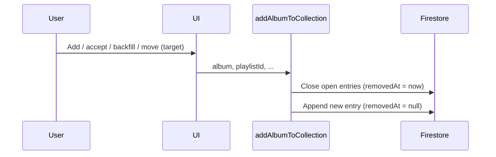
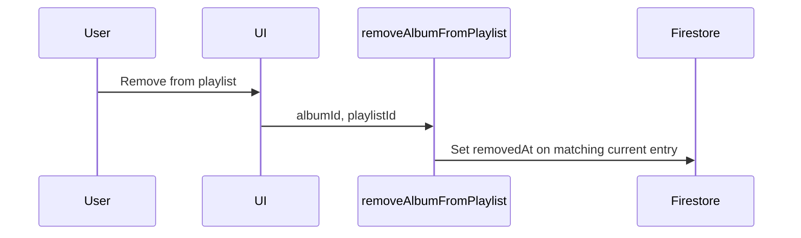
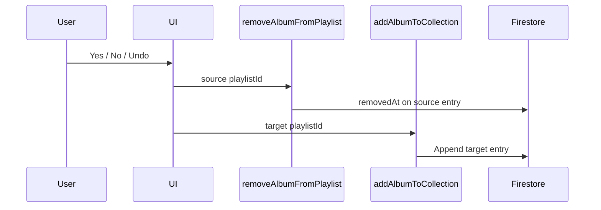

# Playlist History: User Actions

Reference for every **user-facing action** that modifies `userEntries.*.playlistHistory` on `albums/{albumId}` documents — specifically actions that **append** a new history entry or **set** `removedAt`.

**Write layer:** All app mutations go through two functions in `src/composables/useAlbumsData.js`:

| Function | Effect on `playlistHistory` |
|----------|----------------------------|
| `addAlbumToCollection` | Closes all current entries, then **appends** a new entry |
| `removeAlbumFromPlaylist` | Sets `removedAt` on the matching current entry only (no append) |

Pipeline moves and undo call **both** functions in sequence (remove from source, then add to target).

**Related:** [Firestore: Albums, Playlists & User Entries](./firestore-albums-playlists-user-entries.md)

---

## How the write functions work

### `addAlbumToCollection`

**File:** `src/composables/useAlbumsData.js`

1. Resolves album ID (mappings / title+artist dedup).
2. Loads playlist metadata from `playlists` (or uses `playlistData` if passed).
3. Builds a new entry:
   - `playlistId` — external playlist ID from playlist doc
   - `pipelineRole` — from playlist doc (default `'transient'`)
   - `type` — playlist `group` (e.g. `'known'`, `'new'`)
   - `addedAt` — `spotifyAddedAt` param, or Spotify playlist `added_at`, or `new Date()`
   - `removedAt` — `null`
4. For every existing entry where `removedAt` is falsy, sets `removedAt` to `new Date()` (closes “current” stages).
5. **Appends** the new entry: `playlistHistory: [...updatedHistory, newEntry]`.
6. Writes via `setDoc` with `merge: true` (album root fields + `userEntries.{uid}`).

First-time add (no prior user entry): step 4 is a no-op; only the append runs.

### `removeAlbumFromPlaylist`

**File:** `src/composables/useAlbumsData.js`

1. Resolves album ID to primary.
2. Finds the **current** entry where `entry.playlistId === playlistId` and `!entry.removedAt`.
3. Sets that entry’s `removedAt` to `new Date()`.
4. Writes via `updateDoc` with dot notation: `userEntries.{uid}` (preserves other users’ entries).

Does **not** append. After a pure remove, the album has no current stage (`removedAt == null` on any entry).

---

## Actions that append to `playlistHistory`

Each row is a user action that ends in `addAlbumToCollection` (and therefore appends one entry). Moves also call `removeAlbumFromPlaylist` first (see next section).

| # | User action | UI / entry point | File | Notes |
|---|-------------|------------------|------|--------|
| 1 | **Add album to playlist** | Submit on Add Album to Playlist page | `src/views/playlists/AddAlbumToPlaylistView.vue` | Adds to Spotify playlist, then `addAlbumToCollection` with `spotifyAddedAt: new Date()`. |
| 2 | **Accept album recommendation** | Accept flow on recommendations | `src/composables/useAlbumRecommendations.js` → `acceptRecommendation` | Blocked if user already has album in a playlist (`getCurrentPlaylistInfo`). Adds to chosen playlist, then `addAlbumToCollection`. |
| 3 | **Add single album to DB** | “Add” on album row when album is in Spotify playlist but not in Firestore | `src/components/AlbumItem.vue` → `handleAddToCollection` | Used on Playlist Single when `inCollection` is false. Spotify already has the album; only writes Firestore history for current playlist. |
| 4 | **Batch add missing albums to DB** | “Add N Missing Albums to DB” on Playlist Single | `src/views/playlists/PlaylistSingle.vue` → `batchAddAlbumsToDatabase` | Backfills Firestore for albums already on the Spotify playlist. Preserves Spotify `added_at` per album when available. |
| 5 | **Pipeline Yes** (advance) | Thumbs-up / advance button on album row | `PlaylistSingle.vue` → `handleProcessAlbum` (`action === 'yes'`) | Moves to `nextStagePlaylistId` stage. `removeAlbumFromPlaylist` (source) → Spotify move → `addAlbumToCollection` (target). |
| 6 | **Pipeline No** (terminate) | Archive / terminate button on album row | `PlaylistSingle.vue` → `handleProcessAlbum` (`action === 'no'`) | Moves to `terminationPlaylistId` (sink). Same Firestore sequence as Yes. |
| 7 | **Undo move** (terminal/sink) | Undo button on album row | `PlaylistSingle.vue` → `handleUndoAlbum` | Moves back to previous playlist from history. `removeAlbumFromPlaylist` (current) → Spotify move → `addAlbumToCollection` (previous). `spotifyAddedAt: new Date()`. |

### What gets appended (new entry shape)

Every append uses the same entry shape from `addAlbumToCollection`:

| Field | Source |
|-------|--------|
| `playlistId` | Target playlist’s external ID |
| `type` | Target playlist `group` |
| `pipelineRole` | Target playlist `pipelineRole` |
| `addedAt` | See action-specific notes above |
| `removedAt` | Always `null` on the new entry |

---

## Actions that set `removedAt`

### Via `removeAlbumFromPlaylist` only

| # | User action | UI / entry point | File | Notes |
|---|-------------|------------------|------|--------|
| 1 | **Remove album from playlist** | Trash / remove confirm on Playlist Single | `PlaylistSingle.vue` → `performRemoveAlbum` | Removes from Spotify, then marks current entry for this `playlistId` as removed. Album leaves pipeline without a new stage. |

### Via `addAlbumToCollection` (close before append)

Any call to `addAlbumToCollection` also sets `removedAt` on **every** entry that still has `removedAt == null`, immediately before appending. That includes actions **1–7** in the append table.

For pipeline moves and undo, `removeAlbumFromPlaylist` usually closes the source entry first; `addAlbumToCollection` then typically finds no open entries and only appends.

### Combined sequence (remove + append)

These user actions set `removedAt` on the **source** playlist entry, then append a **target** entry:

| User action | Closes (source) | Appends (target) |
|-------------|-----------------|------------------|
| Pipeline Yes | Current playlist | Next stage playlist |
| Pipeline No | Current playlist | Termination (sink) playlist |
| Undo | Current terminal/sink playlist | Previous playlist from history |

---

## Actions that do **not** modify `playlistHistory`

| Action | Why |
|--------|-----|
| **Remove album** on Playlist Management page | `PlaylistManagementView.vue` calls `removeAlbumFromPlaylist` from **`useUserSpotifyApi`** (Spotify only). Does not update Firestore. |
| **Update album** (metadata) on Playlist Single | `handleUpdateAlbumDetails` → `updateAlbumDetails` — root fields only (`albumCover`, `artistId`, `releaseYear`). |
| **Edit album notes** on Album page | `updateAlbumNotes` — updates `notes` and `updatedAt` only. |
| **View** playlist history timeline | Read-only (`PlaylistHistoryTimeline.vue`, `AlbumView.vue`). |

---

## Non-user / maintenance writes

| Script | Behavior |
|--------|----------|
| `dbscripts/dedupe-albums.js` → `mergeUserEntries` | When merging duplicate album documents, **concatenates** `playlistHistory` arrays for users present on both docs. Does not apply `removedAt` rules; admin/maintenance only. |

---

## Semantics & invariants

- **Current stage:** The entry with `removedAt == null`. At most one should be open per user per album in normal operation.
- **History is append-only:** Past entries are kept; “leaving” a stage sets `removedAt`, it does not delete rows.
- **`removedAt` timestamps:** Both write functions use client `new Date()`, not `serverTimestamp()`.
- **`addedAt` on new entries:** Usually Spotify playlist add time when backfilling; pipeline moves and undo use `new Date()` at move time.
- **ID resolution:** Both functions resolve alternate album IDs to primary before read/write.

---

## Flow diagrams

### Add to collection (first time or re-enter pipeline)

### Remove from playlist (leave pipeline)

### Pipeline move (Yes / No / Undo)

---

## Quick lookup

| I want to know… | Look at |
|-----------------|--------|
| Append implementation | `useAlbumsData.js` → `addAlbumToCollection` (~line 427) |
| `removedAt`-only implementation | `useAlbumsData.js` → `removeAlbumFromPlaylist` (~line 775) |
| Yes / No pipeline | `PlaylistSingle.vue` → `handleProcessAlbum` |
| Undo | `PlaylistSingle.vue` → `handleUndoAlbum` |
| Remove | `PlaylistSingle.vue` → `performRemoveAlbum` |
| Add from search flow | `AddAlbumToPlaylistView.vue` |
| Recommendation accept | `useAlbumRecommendations.js` → `acceptRecommendation` |
